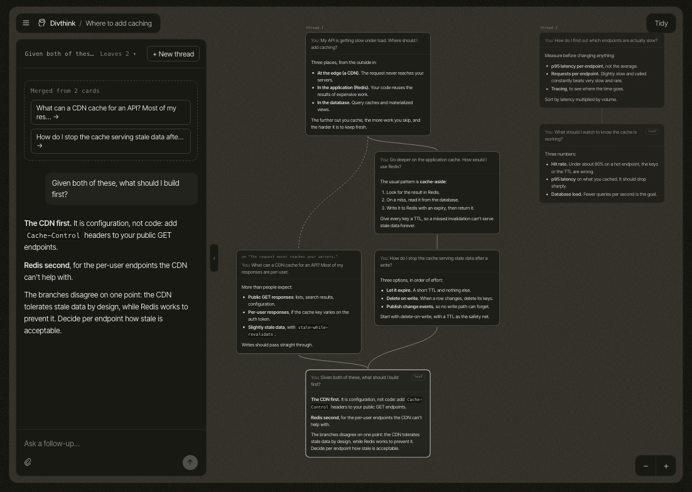

<div align="center">

# Divthink

**Conversations that branch instead of scrolling.**

[divthink.com](https://divthink.com) · [Features](#features) · [Run locally](#run-locally) · [How it works](#how-it-works)

<br>



</div>

<br>

Divthink is a chat app where the conversation is a graph on a canvas. You chat in a panel as
usual, but every prompt and its reply is also a card you can go back to. Reply from an earlier
card to branch, start separate threads side by side, and merge any cards so the model answers
with all of their context.

It is free to use with your own Anthropic or Google API key.

## Features

| | |
| --- | --- |
| **Branch** | Reply from any earlier card, or highlight a passage in a reply and ask about exactly that. The line you were on carries on. |
| **Threads** | Several independent conversations sit side by side on one canvas. |
| **Merge** | Pick two or more cards, from one thread or several, and ask one question across them. The model gets their shared history once, then each branch on its own. |
| **Leaves** | A list of every card you can keep going from, newest first. |
| **A model per reply** | Claude Sonnet, Claude Opus or Gemini Flash, chosen each time you send. Prompts can carry images and PDFs, and replies can search the web. |
| **Your layout** | Cards are placed automatically, and can be dragged and resized. Tidy puts them back. |

## Stack

| Part | Built with |
| --- | --- |
| Frontend | React 19, TypeScript, Vite, Zustand, React Flow, dagre, plain CSS Modules |
| Backend | Python 3.13, FastAPI, asyncpg |
| Database | Postgres (Supabase in production, Docker locally) |
| Sign-in | Supabase Auth with Google |
| Models | Anthropic and Google, called with each user's own key |
| Hosting | Vercel (frontend), Railway (backend) |

## Run locally

**Requirements:** Docker, Python 3.13 and Node 22.

```bash
# Database, on localhost:5433. The schema is applied the first time it starts.
docker compose up -d

# Backend, on localhost:8000
cd backend
python3 -m venv .venv && .venv/bin/pip install -r requirements.txt
cp .env.example .env   # then add ANTHROPIC_API_KEY and/or GOOGLE_API_KEY
.venv/bin/uvicorn app.main:app --reload --timeout-graceful-shutdown 3

# Frontend, on localhost:5173 (new terminal)
cd frontend
nvm use && npm install && npm run dev
```

Then open http://localhost:5173.

With the Supabase settings left empty there is no sign-in: the app opens straight on the
canvas as a built-in dev user, whose model keys come from `backend/.env`. To test sign-in
locally, set `SUPABASE_URL` in `backend/.env`, and `VITE_SUPABASE_URL` and
`VITE_SUPABASE_PUBLISHABLE_KEY` in `frontend/.env.local`. Signed out, the same address shows
the landing page.

### Settings

Backend (`backend/.env`, see `backend/.env.example`):

| Variable | What it is for |
| --- | --- |
| `DATABASE_URL` | The Postgres connection. |
| `KEY_ENCRYPTION_KEY` | Encrypts users' saved API keys. Required in production. |
| `SUPABASE_URL` | Turns sign-in on. Required in production. |
| `ANTHROPIC_API_KEY`, `GOOGLE_API_KEY` | Local development only: the dev user's keys. |
| `ENVIRONMENT`, `CORS_ORIGINS` | Production only. |

Frontend (`frontend/.env.local`, see `frontend/.env.example`):

| Variable | What it is for |
| --- | --- |
| `VITE_API_URL` | The backend's address. Empty locally, where Vite proxies `/api` to port 8000. |
| `VITE_SUPABASE_URL`, `VITE_SUPABASE_PUBLISHABLE_KEY` | Turn sign-in on. |

### Checks

```bash
cd frontend
npm run build   # type-check and production build
npm run lint
```

## How it works

**Data.** A canvas is a `session`. Each prompt and each reply is a row in `nodes`, joined by
rows in `edges`; a prompt with several parents is a merge. The frontend folds every prompt and
its reply into one card. The schema is `backend/db/schema.sql`.

**Sending a prompt.** The browser posts the prompt and the cards it continues from. The server
saves the prompt and an empty reply, returns at once, and fills the reply in from a background
task. Everything that happens to a canvas afterwards (new cards, streamed text, deletions)
reaches every open tab over one server-sent event stream per canvas.

**Context.** What the model sees is assembled on the server from the graph
(`backend/app/context.py`): the cards above the prompt, oldest first. For a merge, and for
everything that continues from one, it is the history the branches share, then each branch in
its own labelled block. To see exactly what would be sent for a node:

```bash
cd backend && .venv/bin/python -m scripts.show_context <node_id>
```

**Layout.** Card positions are worked out in the browser by dagre, one thread at a time. A
card that has been dragged or resized keeps its place, saved with the card.

**Keys.** Users' API keys are encrypted before they are stored, decrypted only to generate a
reply, and never sent back to the browser.

## Repository layout

```
backend/
  app/
    main.py          the FastAPI app
    routes/          HTTP endpoints: sessions, generate, nodes, stream, keys, models
    context.py       builds the conversation sent to the model
    generation.py    background reply jobs
    events.py        the in-memory event bus behind the live stream
    providers/       Claude and Gemini adapters, and the list of models
  db/                schema.sql, seed.sql, migrations/
frontend/
  src/
    Landing.tsx      the public home page, with the interactive demo (demo.ts)
    Canvas.tsx       the app: canvas, cards and layout
    Panel.tsx        the conversation panel and composer
    exchanges.ts     folds prompt and reply nodes into cards
    layout.ts        where cards go
    store.ts         app state and the live stream
```

## Deploying

The frontend deploys to Vercel from `frontend/` and the backend to Railway from
`backend/Dockerfile`. Deploy them together: the frontend expects the backend's current routes.

The backend must run as a **single instance**. Live updates and in-progress replies are held
in that process's memory, so a second instance would not see them, and a redeploy cuts off any
reply being written at that moment.

Changes to the database are the SQL files in `backend/db/migrations/`, applied by hand.
